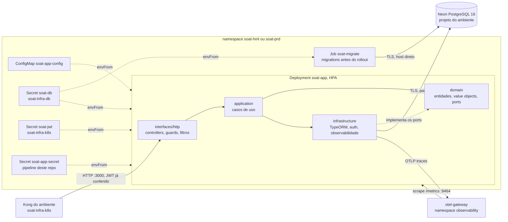

# Auto Repair Shop OS Management System

[](https://github.com/gomes-leonardo/fiap-software-architecture/actions/workflows/ci-cd.yml)

Sistema de gestão de ordens de serviço para oficina mecânica, do Tech Challenge da Pós Tech FIAP
(Software Architecture, 13SOAT).

A oficina cadastra clientes, veículos, serviços e peças, abre ordens de serviço (OS), gera
orçamento com preço congelado e acompanha cada OS por uma máquina de status. O cliente final
entra com o CPF e consulta as próprias OS. Parceiros externos aprovam orçamentos e mudam status
por webhook.

A Fase 1 entregou o domínio em camadas e a API. A Fase 2 levou a API para Kubernetes com Terraform
e CI/CD. A **Fase 3** divide o sistema em quatro repositórios, com autenticação serverless por CPF,
API Gateway, banco gerenciado, observabilidade no New Relic e deploy automático em homologação e
produção, a custo zero.

## Integrantes

| Nome | RM |
| --- | --- |
| Vinicius Taked Souza Brunelli | rm374460 |
| Leonardo Rodrigues Gomes | rm374461 |

## Vídeo demonstrativo

> **Pendente.** O link entra aqui antes da entrega (issue
> [#65](https://github.com/gomes-leonardo/fiap-software-architecture/issues/65)).

## Repositórios

| Repositório | Papel |
| --- | --- |
| [fiap-software-architecture](https://github.com/gomes-leonardo/fiap-software-architecture) (este) | Aplicação NestJS, manifestos Kubernetes, Job de migration e pipeline de deploy |
| [soat-auth-lambda](https://github.com/gomes-leonardo/soat-auth-lambda) | Funções serverless: autenticação por CPF e notificação de alertas por e-mail |
| [soat-infra-k8s](https://github.com/gomes-leonardo/soat-infra-k8s) | Cluster Kind, gateway Kong, OpenTelemetry Collector, dashboards e alertas do New Relic |
| [soat-infra-db](https://github.com/gomes-leonardo/soat-infra-db) | Banco gerenciado Neon PostgreSQL, um por ambiente |

## Arquitetura

A visão de nuvem completa, com os quatro repositórios, está em
**[docs/arquitetura/componentes.md](docs/arquitetura/componentes.md)**. Este diagrama mostra o que
este repositório entrega e com quem ele fala:



A seta tracejada entre camadas é a inversão de dependência: o domínio declara os contratos de
repositório e não importa TypeORM, NestJS nem nada de framework.

| Ambiente | Branch | Namespace | Gateway | HPA | Banco |
| --- | --- | --- | --- | --- | --- |
| hml | `develop` | `soat-hml` | `http://127.0.0.1:18081` | 1 a 3 pods | projeto Neon `soat-hml` |
| prd | `main` | `soat-prd` | `http://127.0.0.1:18080` | 2 a 10 pods | projeto Neon `soat-prd` |

Até a ativação das contas, o banco de cada ambiente é um Postgres 16 no próprio namespace, e os
traces vão para um Jaeger no cluster. A tabela do que roda hoje e do que é alvo está em
[componentes.md](docs/arquitetura/componentes.md#o-que-roda-até-a-ativação).

### Diagramas e decisões

| Documento | Conteúdo |
| --- | --- |
| [Componentes](docs/arquitetura/componentes.md) | visão de nuvem: gateway, Lambda, cluster, banco, monitoramento |
| [Sequência de autenticação](docs/arquitetura/sequencia-autenticacao.md) | CPF até o token, uso do token, login de admin |
| [Sequência de abertura de OS](docs/arquitetura/sequencia-abertura-os.md) | `POST /service-orders` com os caminhos de erro |
| [RFCs](docs/rfc/README.md) | nuvem e custo, banco, autenticação, observabilidade, API Gateway |
| [ADRs](docs/adr/README.md) | comunicação síncrona, HPA, migrations em Job, ambientes, segredos |
| [Modelo ER](docs/database/modelo-er.md) e [por que PostgreSQL](docs/database/justificativa-postgresql.md) | banco de dados |
| [Acesso por papel](docs/api/acesso-por-papel.md) | quais rotas o cliente e o admin acessam |

### Camadas

Monolito NestJS com Domain-Driven Design:

```
src/
  domain/          -> entidades, value objects, regras de negócio (zero imports de framework)
  application/     -> casos de uso, DTOs, orquestração
  infrastructure/  -> entidades TypeORM, repositórios, auth, logging, observabilidade
  interfaces/http/ -> controllers, guards, filtros, módulos
```

- **Inversão de dependência.** O domínio define contratos (classes abstratas como
  `ClientRepository`). A infraestrutura implementa.
- **Entidades ricas.** A `ServiceOrder` valida as próprias transições de status.
- **Value objects imutáveis.** `CpfCnpj`, `Plate` e `BudgetLine` se validam na criação.
- **Preço congelado.** O orçamento grava o preço do catálogo no momento da criação.

## Tecnologias

| Camada | Tecnologia |
| --- | --- |
| Aplicação | TypeScript, Node.js 20, NestJS 11, TypeORM 0.3, Passport JWT, class-validator |
| Banco | PostgreSQL 16: Neon nos ambientes, `postgres:16-alpine` no desenvolvimento e nos testes |
| Observabilidade | OpenTelemetry SDK (traces OTLP, métricas Prometheus), logs JSON com `pino` |
| Testes | Jest, Supertest, Testcontainers |
| Contêiner e cluster | Docker (imagem arm64, `tini`, usuário não-root), Kubernetes com Kustomize, HPA `autoscaling/v2` |
| CI/CD | GitHub Actions: runners hospedados para teste e build, runner self-hosted para o deploy; GHCR |
| Fora deste repositório | Kong 3.9, AWS Lambda, SNS, SSM, Neon, New Relic, Terraform |

## Como executar localmente

O `docker-compose.yml` sobe a aplicação com Postgres, Jaeger, Prometheus e Grafana. É o fluxo de
desenvolvimento e não depende de cluster nem de conta nenhuma.

### Pré-requisitos

- Node.js 20+ (o CI roda em 24, exigência do `testcontainers` 12)
- Docker e docker-compose

### Com Docker

```bash
# 1. O .env é obrigatório: o compose falha se DB_PASS, JWT_SECRET, WEBHOOK_SECRET
#    ou ADMIN_BOOTSTRAP_PASSWORD não estiverem definidas
cp .env.example .env

# 2. Subir a stack
docker-compose up -d

curl http://localhost:3000/health
```

A API fica em `http://localhost:3000` e o Swagger em `http://localhost:3000/api-docs`.

> A senha de administrador exige 12 caracteres, com maiúsculas, minúsculas e dígitos. O
> `ADMIN_BOOTSTRAP_PASSWORD` do `.env` precisa cumprir a regra, ou o app recusa o boot num banco
> vazio. Para recomeçar do zero, `docker-compose down -v` apaga o volume.

### Só o banco em contêiner

```bash
npm install
cp .env.example .env
docker-compose up -d db
npm run start:dev
```

O Postgres do compose é publicado só em `127.0.0.1:5432` (`DB_BIND_ADDRESS`). O app em contêiner
não usa essa porta: ele fala com o serviço `db` pela rede `soat-network`.

### Credenciais de admin

Com `npm run start:dev` (`NODE_ENV=development`), o seeder cria o admin de desenvolvimento:

```text
Email: admin@oficina.com
Senha: Admin@Oficina2026
```

No compose, que roda com `NODE_ENV=production`, o admin é o de `ADMIN_BOOTSTRAP_EMAIL` e
`ADMIN_BOOTSTRAP_PASSWORD` do `.env`.

```bash
curl -X POST http://localhost:3000/auth/login \
  -H "Content-Type: application/json" \
  -d '{"email":"admin@oficina.com","password":"<senha>"}'
```

### Observabilidade local

| Porta | O que é |
| --- | --- |
| 9464 | `/metrics` do app, formato Prometheus |
| 9090 | Prometheus, raspa a 9464 a cada 15 s e retém 15 dias |
| 3002 | Grafana, acesso anônimo como Editor, só em loopback |
| 16686 | Jaeger, em memória: um restart apaga os traces |

Prometheus e Grafana ficam em `127.0.0.1` (`OBSERVABILITY_BIND_ADDRESS`). Esta stack é só de
desenvolvimento. Nos ambientes, os mesmos sinais vão para o OpenTelemetry Collector e dele para o
New Relic ([RFC-004](docs/rfc/RFC-004-observabilidade.md)).

## Deploy

O deploy é automático: push em `develop` publica em hml, push em `main` publica em prd. Pull
request roda os testes, o build, o scan e o render dos manifestos, sem publicar nada.

```
lint, typecheck, unit, integration ──> smoke ──> build arm64 ──> Trivy ──> GHCR ──┐
render dos overlays (kustomize + kubeconform) ─────────────────────────────────────┴──> deploy hml | prd
                                                                                         runner self-hosted
```

O job de deploy roda no runner self-hosted do Mac onde está o cluster Kind: recria o Secret
`soat-app-secret`, roda o Job de migration, aplica o overlay com a imagem do commit, faz o smoke
de `/health` pelo Kong e, se algo falhar, reverte o Deployment.

| Referência | Conteúdo |
| --- | --- |
| [.github/DEPLOYMENT.md](.github/DEPLOYMENT.md) | jobs, ambientes, runner, secrets por Environment, GHCR, ordem do deploy |
| [k8s/README.md](k8s/README.md) | base e overlays Kustomize, Secrets e seus donos, como aplicar à mão |
| [.github/BRANCH_PROTECTION.md](.github/BRANCH_PROTECTION.md) | checks exigidos na `main` |

O cluster, o gateway e o banco têm pipeline próprio nos repositórios de infraestrutura, e precisam
estar de pé antes do primeiro deploy da aplicação.

## Endpoints da API

Em hml e prd, a API é acessada pelo Kong do ambiente. Rotas protegidas exigem
`Authorization: Bearer <token>`, e o papel do token decide o acesso: cliente só acessa `/me`, admin
acessa o resto ([acesso por papel](docs/api/acesso-por-papel.md)). Sem token, a resposta é 401.
Com o papel errado, 403.

### Autenticação

| Método | Rota | Acesso | Descrição |
| --- | --- | --- | --- |
| POST | `/auth/cpf` | público, só pelo Kong | CPF do cliente; responde JWT de cliente (Lambda `auth-cpf`) |
| POST | `/auth/login` | público | e-mail e senha do admin; responde JWT de admin |
| POST | `/auth/register` | admin | cria outro administrador |

### Área do cliente

| Método | Rota | Descrição |
| --- | --- | --- |
| GET | `/me/service-orders` | OS do cliente autenticado |
| GET | `/me/vehicles` | veículos do cliente autenticado |

O id do cliente vem do `sub` do token. Cliente inativado ou excluído perde o acesso na hora, mesmo
com o token dentro da validade.

### Cadastros (admin)

| Recurso | Rotas |
| --- | --- |
| Clientes | `POST /clients`, `GET /clients` (filtro `?cpfCnpj=`), `GET/PUT/DELETE /clients/:id`, `PATCH /clients/:id/status` (ATIVO ou INATIVO) |
| Veículos | `POST /vehicles`, `GET /vehicles`, `GET/PUT/DELETE /vehicles/:id`, `GET /vehicles/client/:clientId` |
| Serviços | `POST /services`, `GET /services`, `GET/PUT/DELETE /services/:id` |
| Peças | `POST /parts`, `GET /parts`, `GET/PUT/DELETE /parts/:id`, `PATCH /parts/:id/stock` (ajuste +/-) |

Cliente `INATIVO` não obtém token na autenticação por CPF.

### Ordens de serviço (admin)

| Método | Rota | Descrição |
| --- | --- | --- |
| POST | `/service-orders` | cria OS (aceita `services` e `parts` inline) |
| GET | `/service-orders` | lista OS ativas (filtros `?status=` e `?clientId=`) |
| GET | `/service-orders/:id` | busca por id |
| PATCH | `/service-orders/:id/status` | altera status |
| PUT | `/service-orders/:id` | atualiza descrição |
| DELETE | `/service-orders/:id` | exclui (lógico) |
| GET | `/service-orders/metrics/average-execution-time` | tempo médio de execução |
| GET | `/service-orders/metrics/operational-report` | OS por status, estoque baixo, tempo médio |

Sem filtro, `GET /service-orders` retorna só as OS ativas, sem as terminais (`FINALIZADA`,
`ENTREGUE`, `ENCERRADA_SEM_EXECUCAO`), na prioridade `EM_EXECUCAO` > `AGUARDANDO_APROVACAO` >
`EM_DIAGNOSTICO` > `RECEBIDA` > `PAUSADO` e, no mesmo status, da mais antiga para a mais recente.

#### Abertura com serviços e peças inline

```json
{
  "clientId": "...",
  "vehicleId": "...",
  "description": "Revisão completa",
  "services": [{ "referenceId": "<id do serviço>", "quantity": 1 }],
  "parts": [{ "referenceId": "<id da peça>", "quantity": 2 }]
}
```

- Com qualquer item, a OS nasce com um orçamento `PENDENTE` e já em `AGUARDANDO_APROVACAO`. Sem
  itens, nasce em `RECEBIDA`, sem orçamento.
- Preço e descrição **nunca** vêm da requisição: são lidos do catálogo e congelados no orçamento.
- `createdBudgetId` é o orçamento recém-criado. `budgetId` continua `null`: ele significa
  "orçamento aprovado" e só a aprovação o preenche, depois de dar baixa no estoque.
- `stockWarnings` avisa falta de estoque sem bloquear a abertura. A falta só barra na aprovação.
- `referenceId` inexistente, cliente inexistente ou veículo de outro cliente respondem `400` sem
  gravar nada.

O passo a passo está no [diagrama de sequência](docs/arquitetura/sequencia-abertura-os.md).

### Orçamentos (admin)

| Método | Rota | Descrição |
| --- | --- | --- |
| POST | `/budgets` | cria orçamento |
| GET | `/budgets/:id` | busca por id |
| GET | `/budgets/service-order/:serviceOrderId` | orçamentos da OS |
| PATCH | `/budgets/:id/approve` | aprova: baixa no estoque e vincula à OS |
| PATCH | `/budgets/:id/refuse` | recusa: encerra a OS sem execução |
| DELETE | `/budgets/:id` | exclui (lógico) |

Só um orçamento `PENDENTE` aceita decisão (`400` caso contrário). Estoque insuficiente bloqueia a
aprovação inteira, sem decrementar nada.

### Consulta pública

| Método | Rota | Descrição |
| --- | --- | --- |
| GET | `/consult/:clientId?cpf=` | OS do cliente, conferindo o CPF/CNPJ |

Cliente inexistente e CPF errado respondem o mesmo `404`. Rate limit de 20 requisições por minuto
por `clientId`, com `429` e `Retry-After`.

### Health check

`GET /health` responde `{"status":"ok","database":"connected"}`, ou `503` sem banco. Alimenta o
`HEALTHCHECK` da imagem, as probes do Kubernetes, o smoke do deploy e o alerta de API indisponível.

### Webhooks de integração

| Método | Rota | Descrição |
| --- | --- | --- |
| POST | `/webhooks/service-orders/:id/status` | muda o status da OS a partir de sistema externo |
| POST | `/webhooks/budgets/:id/approve` | aprova orçamento por canal externo |
| POST | `/webhooks/budgets/:id/refuse` | recusa orçamento por canal externo |

Para sistemas sem usuário, como gateway de e-mail ou portal do cliente. A credencial é o
`WEBHOOK_SECRET`, no header `Authorization: Bearer` (preferido) ou no campo `token` do corpo.

```bash
curl -X POST http://127.0.0.1:18081/webhooks/service-orders/<id>/status \
  -H "Authorization: Bearer $WEBHOOK_SECRET" \
  -H 'Content-Type: application/json' \
  -d '{"status":"EM_DIAGNOSTICO","changedBy":"gateway-email"}'
```

- Sem `WEBHOOK_SECRET` configurada, o endpoint recusa toda chamada.
- A comparação é de tempo constante, sobre os digests SHA-256.
- O webhook usa os mesmos casos de uso do canal autenticado. Vir de fora não permite pular etapa:
  transição ilegal responde `400`, e aprovar dá a mesma baixa no estoque.

## Máquina de status da OS

```
Recebida -> Em diagnóstico -> Aguardando aprovação -> Em execução -> Finalizada -> Entregue

Exceções:
  Em execução -> Aguardando aprovação   (re-orçamento)
  Em execução <-> Pausado               (pausa por estoque)
  Aguardando aprovação -> Encerrada sem execução (recusa do cliente)
```

- `EM_EXECUCAO` só é permitida com orçamento aprovado (`budgetId` preenchido).
- A aprovação vincula o `budgetId`, mas não inicia a execução: o mecânico decide quando.
- A baixa de estoque acontece na aprovação, depois de conferir a disponibilidade de todas as peças.
- A partir de `EM_EXECUCAO`, a OS pode voltar para `AGUARDANDO_APROVACAO` com um novo orçamento
  versionado.

## Exclusão lógica

`DELETE` não apaga linha: todas as entidades têm `deleted_at`, e um `GET` do mesmo id responde
`404`. Os índices únicos (CPF/CNPJ, placa, SKU, nome de serviço, e-mail) são parciais
(`WHERE deleted_at IS NULL`), para que um registro excluído não segure o valor para sempre.

## Testes

```bash
npm run test:unit           # unitários
npm run test:integration    # integração (Docker, para o Testcontainers)
npm run test:smoke          # sobe o AppModule real e bate nos endpoints por HTTP
npm test                    # tudo
npm run test:cov            # cobertura
```

| Suíte | Onde | O que cobre |
| --- | --- | --- |
| Unitários | `test/unit/` | entidades, value objects, casos de uso, guards |
| Integração | `test/integration/` | Postgres real: migrations e FKs, papéis, soft delete, orçamento, estoque concorrente, métricas de negócio |
| Smoke | `test/smoke/` | a aplicação inteira subindo e respondendo pelo caminho crítico |

As três rodam no pipeline antes do build da imagem, com gate de 80% de cobertura em `src/domain`.

## Documentação da API

| Recurso | Onde |
| --- | --- |
| Spec OpenAPI versionado | [docs/swagger.json](docs/swagger.json) |
| Collection do Postman | [docs/postman-collection.json](docs/postman-collection.json) |
| Swagger UI local | `http://localhost:3000/api-docs` |
| Swagger UI em hml | `http://127.0.0.1:18081/api-docs` (desligado em prd) |

Os dois arquivos são gerados do código com `npm run docs:api`. Como importar a collection e
preencher as variáveis: [docs/README.md](docs/README.md).

## Segurança

Relatório de vulnerabilidades com os outputs brutos de `npm audit`, Trivy e Semgrep:
**[SECURITY.md](SECURITY.md)**.

- Token validado duas vezes: no Kong (assinatura e expiração) e na aplicação (`iss` coerente com o
  `role`, `RolesGuard` por rota).
- Kong deny-by-default: caminho não declarado recebe 404 no gateway.
- Senhas com bcrypt e política de 12 caracteres com maiúsculas, minúsculas e dígitos.
- Rate limit no login, na consulta pública e, no Kong, na autenticação por CPF.
- CORS por allowlist (`CORS_ORIGINS`) e Swagger desligado em prd.
- Webhooks com segredo comparado em tempo constante e falha fechada.
- Contêiner não-root, com `readOnlyRootFilesystem`, sem capabilities e com `seccomp` padrão.
- Nenhum segredo versionado: cada Secret tem um dono, e o CI acessa a AWS por OIDC
  ([ADR-005](docs/adr/ADR-005-segredos-terraform-ssm.md)).
- `npm audit` e Trivy em todo push e pull request. Eles não bloqueiam o pipeline: o relatório fica
  em [SECURITY.md](SECURITY.md).
