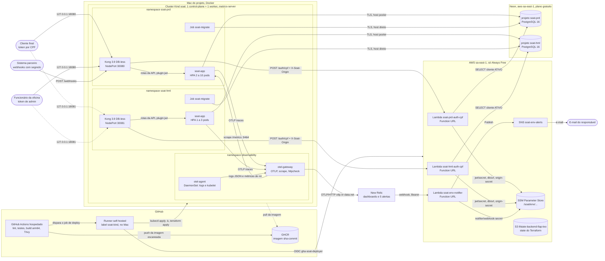
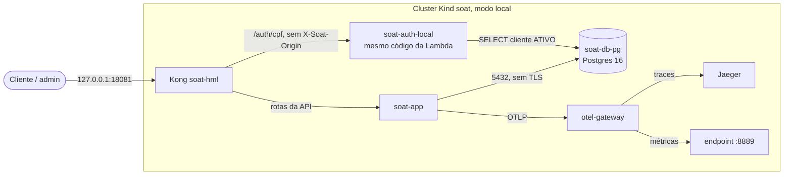

# Diagrama de componentes: visão de nuvem

Issue [#56](https://github.com/gomes-leonardo/fiap-software-architecture/issues/56). Este documento
mostra quais componentes formam o sistema na Fase 3, onde cada um roda e como se ligam: gateway,
função serverless de autenticação, cluster Kubernetes com a aplicação, banco gerenciado,
monitoramento e notificação.

O sistema se espalha por quatro repositórios:

| Repositório | O que entrega |
|---|---|
| [fiap-software-architecture](https://github.com/gomes-leonardo/fiap-software-architecture) (este) | Aplicação NestJS, manifestos Kustomize, Job de migration, pipeline de deploy |
| [soat-auth-lambda](https://github.com/gomes-leonardo/soat-auth-lambda) | Lambdas `auth-cpf` e `notifier`, SNS, segredos de origem e do webhook |
| [soat-infra-k8s](https://github.com/gomes-leonardo/soat-infra-k8s) | Cluster Kind, Kong por ambiente, OpenTelemetry Collector, dashboards e alertas do New Relic |
| [soat-infra-db](https://github.com/gomes-leonardo/soat-infra-db) | Banco Neon por ambiente, Secret `soat-db` e URL no SSM |

## Arquitetura alvo

Linha contínua é o caminho de produção (`soat-prd`). Linha tracejada é homologação ou ação
de apoio. Os dois ambientes têm a mesma forma: o que muda é a porta do host, o tamanho do HPA e o
projeto do Neon.

### Banco por ambiente

A aplicação não escolhe o banco. Ela lê o Secret `soat-db` do próprio namespace, criado pelo
`soat-infra-db`. Cada ambiente aponta para uma instância, sem alternativa:

| Ambiente | Namespace | Banco da aplicação e da Lambda | Host usado pela aplicação | Host usado pelo Job de migration |
|---|---|---|---|---|
| prd | `soat-prd` | projeto Neon **`soat-prd`** | pooler (PgBouncer), TLS | direto, sem pooler, TLS |
| hml | `soat-hml` | projeto Neon **`soat-hml`** | pooler (PgBouncer), TLS | direto, sem pooler, TLS |
| desenvolvimento | máquina do desenvolvedor | Postgres 16 do `docker-compose.yml` | `db` na rede `soat-network` | o próprio app no boot |

O host direto existe porque o pooler do Neon opera em modo transação, que não é indicado para
DDL. A URL do banco de cada ambiente também vai para o SSM (`/soat/<env>/db/url`), porque a Lambda
não enxerga o Secret do cluster.

### Quem fala com quem

| Origem | Destino | Protocolo | Autenticação |
|---|---|---|---|
| Cliente, admin, parceiro | Kong do ambiente | HTTP, porta do host 18080 (prd) ou 18081 (hml) | conforme a rota |
| Kong | `soat-app.<ns>.svc.cluster.local:3000` | HTTP no cluster | JWT conferido no Kong e de novo na aplicação |
| Kong | Lambda `auth-cpf` | HTTPS, Function URL | header `X-Soat-Origin` com segredo que só o Kong e a função conhecem |
| Aplicação e Job | Neon | PostgreSQL, TLS | usuário e senha do Secret `soat-db` |
| Lambda `auth-cpf` | Neon | PostgreSQL, TLS | URL lida do SSM |
| Lambdas | SSM | API da AWS | papel IAM da função, leitura só de `/soat/<env>/*` |
| Aplicação | `otel-gateway.observability:4318` | OTLP/HTTP | rede do cluster |
| `otel-gateway` | New Relic | OTLP/HTTP | license key no Secret `nr-license` |
| New Relic | Lambda `notifier` | HTTPS, Function URL | `Authorization: Bearer <segredo do webhook>` |
| Runner self-hosted | Kind e AWS | `kubectl` local; OIDC na AWS | contexto `kind-soat`; papel `gha-soat-deployer` por Environment |

A comunicação é toda síncrona, por HTTP. O motivo está na
[ADR-001](../adr/ADR-001-comunicacao-sincrona-http.md).

## O que roda até a ativação

Neon, New Relic e Lambda dependem de contas e chaves que são cadastradas por último. Até lá, cada
um tem um equivalente que roda no próprio cluster, atrás do mesmo contrato. A troca é uma variável
de pipeline e um novo deploy, sem mudança de código na aplicação.

| Componente | Até a ativação | Alvo | Variável de troca | Repositório |
|---|---|---|---|---|
| Banco | Postgres 16 no namespace do ambiente (Service `soat-db-pg`, `DB_SSL=false`) | projeto Neon do ambiente (`DB_SSL=true`) | `DB_BACKEND=local` ou `neon` | `soat-infra-db` |
| Autenticação por CPF | Deployment `soat-auth-local` no namespace do ambiente, porta 8080, mesmo código da Lambda | Lambda `soat-<env>-auth-cpf` pela Function URL | `AUTH_MODE=local` ou `lambda` | `soat-infra-k8s/gateway` |
| Traces | Jaeger no namespace `observability` | New Relic | `NEW_RELIC_ENABLED=false` ou `true` | `soat-infra-k8s/observability` |
| Métricas | endpoint Prometheus `:8889` do `otel-gateway` | New Relic | idem | idem |
| Logs | stdout do collector | New Relic | idem | idem |
| Dashboards e alertas | não aplicados (o CI só faz `validate`) | aplicados por Terraform | idem | `soat-infra-k8s/newrelic` |

Em 30/10/2026 os três estão no modo local. A ativação de cada um é um pull request próprio no
repositório dono da variável.

O Postgres local vive dentro do cluster: recriar o Kind apaga os dados dele. É o preço do
equivalente local, e um dos motivos para o Neon ser o alvo.

## O que nunca foi aplicado

| Código | Onde | Por quê |
|---|---|---|
| EKS com VPC, subnets e NAT | `soat-infra-k8s/reference/aws-eks/` | custo mensal; o CI só roda `validate` |
| RDS PostgreSQL com Secrets Manager | `soat-infra-db/reference/aws-rds/` | custo mensal; o CI só roda `validate` |

Os dois diretórios mostram como a mesma topologia ficaria numa AWS paga. A justificativa está na
[RFC-001](../rfc/RFC-001-nuvem-e-custo.md).

## Caminho de uma requisição autenticada

1. O cliente pede um token: `POST /auth/cpf` no Kong do ambiente. O Kong aplica rate limit, injeta
   o segredo de origem e chama a Lambda. Ela valida o CPF, consulta o cliente ativo no Neon e
   devolve um JWT assinado com o segredo lido do SSM.
2. O cliente chama `GET /me/service-orders` com o token. O plugin `jwt` do Kong escolhe o consumer
   pelo `iss`, confere assinatura e expiração e repassa para `soat-app:3000`.
3. A aplicação valida o token de novo, confere o papel com o `RolesGuard` e lê os dados no Neon
   pelo pooler.

O passo a passo, com os erros possíveis, está em
[sequencia-autenticacao.md](sequencia-autenticacao.md) e
[sequencia-abertura-os.md](sequencia-abertura-os.md).

## Fontes

- Manifestos da aplicação: [`k8s/`](../../k8s/README.md)
- Pipeline: [`.github/DEPLOYMENT.md`](../../.github/DEPLOYMENT.md)
- Rotas e papéis: [`docs/api/acesso-por-papel.md`](../api/acesso-por-papel.md)
- Rotas do Kong: `soat-infra-k8s/gateway/templates/kong.yml.tftpl`
- Alertas: `soat-infra-k8s/newrelic/ALERTAS.md`
