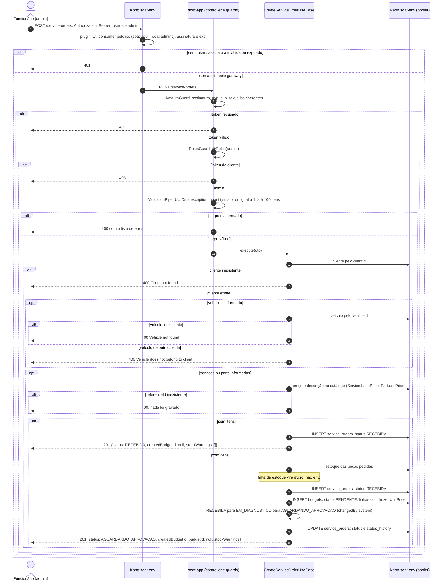

# Sequência: abertura de ordem de serviço

Issue [#56](https://github.com/gomes-leonardo/fiap-software-architecture/issues/56). Abrir OS é
operação da oficina: `POST /service-orders` exige token de admin. O corpo traz o cliente, o
veículo opcional, a descrição e, opcionalmente, `services` e `parts` do catálogo.

```json
{
  "clientId": "<uuid>",
  "vehicleId": "<uuid, opcional>",
  "description": "Revisão completa",
  "services": [{ "referenceId": "<id do serviço>", "quantity": 1 }],
  "parts": [{ "referenceId": "<id da peça>", "quantity": 2 }]
}
```



As respostas da aplicação voltam pelo Kong até o funcionário. O diagrama encurta essa volta para
caber.

## O que o diagrama mostra

- **Duas barreiras de autenticação.** O Kong recusa token forjado ou vencido (401). A aplicação
  confere de novo e decide o papel: token de cliente válido chega na aplicação e recebe 403.
- **Veículo de outro cliente é 400.** A chave estrangeira garante que o veículo existe, mas não
  que ele é do cliente da OS. Essa regra é do caso de uso, e responde 400 pelo
  `DomainExceptionFilter`, que registra a recusa no log como `domain exception`.
- **Tudo é resolvido antes da primeira escrita.** Cliente, veículo e itens do catálogo são
  conferidos primeiro. Um `referenceId` errado não deixa OS órfã.
- **Preço congelado.** Preço e descrição de cada linha vêm do catálogo, nunca da requisição, e
  ficam gravados no orçamento. Uma mudança posterior no catálogo não altera o valor combinado.
- **A ordem das escritas define o estrago de uma falha.** Não há transação envolvendo as três
  escritas. A OS é gravada em `RECEBIDA`, depois o orçamento, e só então a OS avança. Se o
  processo cair no meio, sobra uma OS `RECEBIDA`, estado válido, e nunca uma OS aguardando
  aprovação sem orçamento.
- **`budgetId` continua `null`.** Ele significa "orçamento aprovado" e destrava `EM_EXECUCAO`.
  Quem o preenche é a aprovação, depois de dar baixa no estoque. `createdBudgetId` é o orçamento
  que acabou de nascer.

## Efeitos fora da resposta

| Efeito | Onde aparece |
|---|---|
| Trace da requisição, com um span por consulta ao Postgres | `otel-gateway` e New Relic (Jaeger até a ativação) |
| Linha de log JSON com `trace_id` e `span_id` | stdout do pod, lido pelo `otel-agent` |
| A OS entra na contagem do dia em `soat_service_orders_created_by_day` | `/metrics`, painel de volume diário |
| Um 400 de domínio conta em `soat_integration_errors_total{kind="domain_rejected"}` | painel de erros de integração |

## Fontes

- `src/interfaces/http/service-order/service-order.controller.ts`
- `src/application/service-order/create-service-order.use-case.ts`
- `src/application/budget/budget-line-resolver.ts`
- `test/integration/service-order/inline-items.integration.spec.ts`
- Rotas protegidas no Kong: `soat-infra-k8s/gateway/templates/kong.yml.tftpl`
