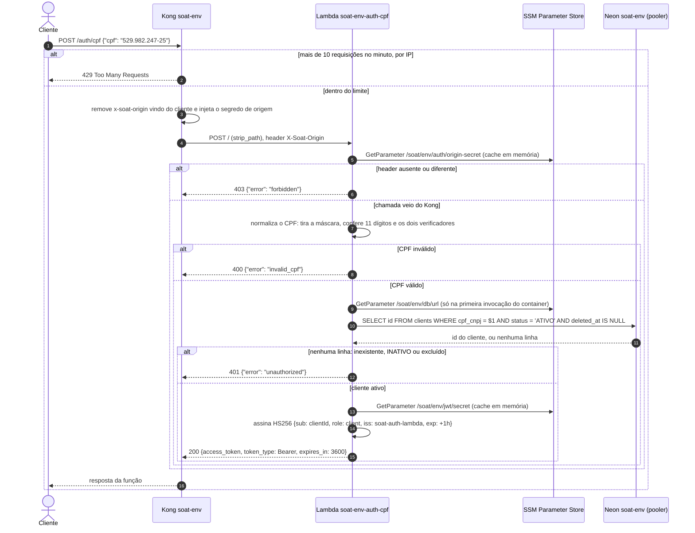
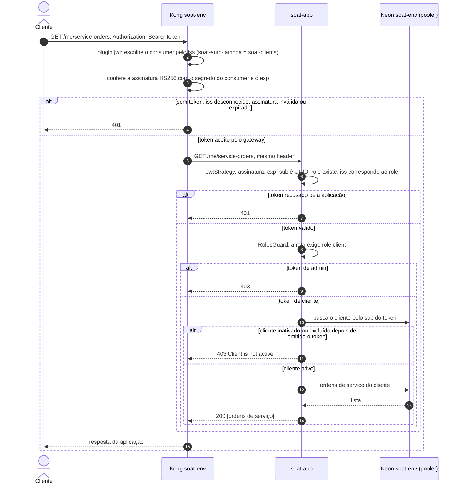
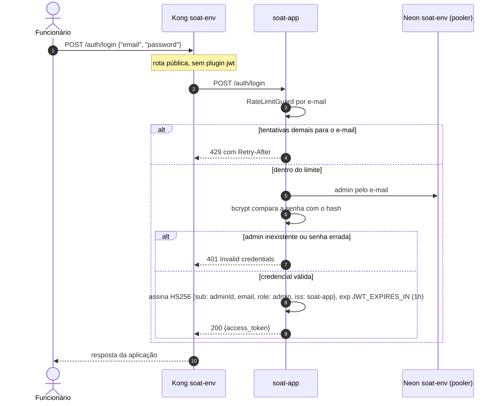

# Sequência: autenticação

Issue [#56](https://github.com/gomes-leonardo/fiap-software-architecture/issues/56). Dois emissores
de token, um segredo por ambiente, duas barreiras de validação.

| Quem | Como pede | Quem valida a credencial | Quem consulta a base | Quem emite o token | `iss` |
|---|---|---|---|---|---|
| Cliente final | `POST /auth/cpf` com o CPF | Lambda `auth-cpf` (dígitos verificadores) | Lambda `auth-cpf`, no Neon | Lambda `auth-cpf` | `soat-auth-lambda` |
| Funcionário da oficina | `POST /auth/login` com e-mail e senha | aplicação (bcrypt) | aplicação | aplicação | `soat-app` |

Os dois tokens são HS256, assinados com o mesmo `JWT_SECRET` do ambiente. O Terraform do
`soat-infra-k8s/gateway` gera esse segredo e o entrega em três lugares: o Secret `soat-jwt` (lido
pela aplicação), o parâmetro SSM `/soat/<env>/jwt/secret` (lido pela Lambda) e os consumers do
Kong. Como o segredo é o mesmo, quem separa cliente de admin é o conteúdo do token, `role` e `iss`.

## Cliente: CPF até o token

Três decisões que o diagrama mostra:

- **Inexistente, inativo e excluído dão a mesma resposta.** Um 401 idêntico nos três casos não
  revela se um CPF é cliente da oficina.
- **A Function URL é pública, mas só o Kong passa.** Sem o `X-Soat-Origin` correto a função
  responde 403. Chamar a URL direto não contorna o rate limit do gateway. O Kong apaga o header
  que vier do cliente antes de pôr o dele.
- **O CPF não vai para o log.** A função registra só um trecho mascarado (`***.982.***-**`) quando
  recusa, e o `clientId` quando concede.

### Até a ativação da Lambda

Com `AUTH_MODE=local` (padrão do `soat-infra-k8s/gateway`), o Kong manda `/auth/cpf` para o
Deployment `soat-auth-local` do próprio namespace, na porta 8080. O código de autenticação é o
mesmo da Lambda. Três diferenças: não há segredo de origem (o serviço só é alcançável de dentro
do cluster), o segredo JWT e o banco vêm dos Secrets `soat-jwt` e `soat-db` em vez do SSM, e o
banco é o Postgres local do namespace.

## Cliente: usando o token

As duas validações são independentes de propósito. O Kong barra token forjado ou vencido antes de
gastar a aplicação. A aplicação repete a conferência porque uma chamada de dentro do cluster não
passa pelo Kong, e porque só ela sabe qual papel cada rota exige. O cliente nunca informa de quem
são os dados: o id vem do `sub`.

## Admin: e-mail e senha

Nas chamadas seguintes o plugin `jwt` casa o `iss: soat-app` com o consumer `soat-admins`. O resto
é igual ao fluxo do cliente, com o `RolesGuard` exigindo `role: admin`. Um token de cliente numa
rota de admin chega na aplicação e recebe 403. O caso completo está em
[sequencia-abertura-os.md](sequencia-abertura-os.md).

## Fontes

- Função: `soat-auth-lambda/functions/auth-cpf/` (`auth-cpf.ts`, `client-lookup.ts`, `token.ts`)
- Rotas e plugins do Kong: `soat-infra-k8s/gateway/templates/kong.yml.tftpl`
- Aplicação: `src/infrastructure/auth/jwt.strategy.ts`, `src/infrastructure/auth/roles.guard.ts`,
  `src/interfaces/http/auth/auth.controller.ts`, `src/interfaces/http/me/me.controller.ts`
- Matriz de acesso: [`docs/api/acesso-por-papel.md`](../api/acesso-por-papel.md)
