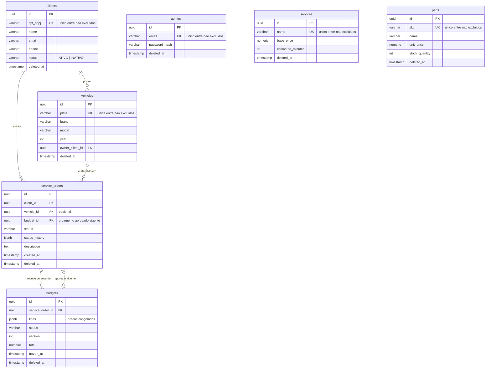

# Modelo relacional

Schema de produção, gerado pelas migrations em `src/infrastructure/database/typeorm/migrations/`.
O teste `test/integration/database/migrations.integration.spec.ts` roda essas migrations num
Postgres real e falha se o schema resultante divergir das entidades ORM. É ele que garante que
este diagrama, as entidades e o banco descrevem a mesma coisa.

## Diagrama

`services` e `parts` são catálogo: o orçamento copia nome e preço para `budgets.lines` no momento em
que é congelado, então não existe chave estrangeira para eles (ver "Linhas do orçamento" abaixo).
`admins` não se relaciona com as outras tabelas.

## Relacionamentos

| Relação | Cardinalidade | O que significa na oficina | Quem garante |
|---|---|---|---|
| `vehicles.owner_client_id → clients` | cliente 1 : N veículos | O carro pertence a um cliente; é por ele que a oficina sabe a quem ligar quando o serviço termina. | **Banco** (`FK_vehicles_owner_client_id`) |
| `service_orders.client_id → clients` | cliente 1 : N OS | Toda OS tem um cliente responsável por aprovar o orçamento e pagar. | **Banco** (`FK_service_orders_client_id`) |
| `service_orders.vehicle_id → vehicles` | veículo 0..1 : N OS | O carro em que o serviço é feito. Opcional porque uma OS pode ser aberta por telefone, antes de o carro chegar. | **Banco** (`FK_service_orders_vehicle_id`). Que o veículo pertença ao mesmo cliente da OS fica a cargo da **aplicação**. |
| `budgets.service_order_id → service_orders` | OS 1 : N orçamentos | Cada revisão de preço gera uma nova versão de orçamento para a mesma OS, e as anteriores ficam como histórico. | **Banco** (`FK_budgets_service_order_id`) |
| `service_orders.budget_id → budgets` | OS 0..1 : 1 orçamento | O orçamento que o cliente aprovou e que autoriza a execução. Fica nulo até a aprovação. | **Banco** (`FK_service_orders_budget_id`). Que o orçamento apontado seja da própria OS fica a cargo da **aplicação**. |

Todas as chaves estrangeiras usam `ON DELETE RESTRICT`. A aplicação nunca apaga linhas, só faz
soft delete. Um `DELETE` físico que deixaria órfãos é sempre um erro, e o banco o recusa.

### As duas ligações que estavam duplicadas

**Cliente e veículo.** Antes, `clients.vehicle_ids` (jsonb) e `vehicles.owner_client_id` descreviam
a mesma relação, e nada garantia que concordassem. A migration `DropClientVehicleIds` remove o
jsonb. A fonte da verdade passa a ser `vehicles.owner_client_id`, que tem chave estrangeira e
índice. A API continua devolvendo `vehicleIds` no cliente, agora calculado a partir dos veículos
não excluídos.

**OS e orçamento.** `budgets.service_order_id` e `service_orders.budget_id` **continuam os dois**.
Não é duplicação, são perguntas diferentes:

- `budgets.service_order_id` responde "quais versões de orçamento esta OS já teve?" (1:N, histórico);
- `service_orders.budget_id` responde "qual orçamento autoriza a execução agora?" (o vigente).

A aplicação só preenche `budget_id` na aprovação, e só com um orçamento da própria OS
(`ApproveBudgetUseCase`). As duas colunas agora têm chave estrangeira. A dependência circular
define a ordem das escritas: a OS é gravada antes do orçamento e só depois aponta para ele
(`CreateServiceOrderUseCase`).

## Status do cliente

`clients.status` (`ATIVO` | `INATIVO`, com `CHECK`) é o status que a autenticação por CPF consulta.
Ele é diferente do soft delete:

- **`INATIVO`**: o cliente existe, seu histórico de OS continua visível para a oficina, mas ele não
  consegue obter token. Reversível por `PATCH /clients/:id/status`.
- **`deleted_at` preenchido**: o cliente foi removido. Some de todas as consultas.

A função de autenticação só emite token quando `status = 'ATIVO' AND deleted_at IS NULL`.

## Soft delete e os relacionamentos

Todas as tabelas têm `deleted_at`. A chave estrangeira não impede o soft delete, porque a linha
continua existindo. Por isso:

- **OS de um cliente excluído continuam existindo**, e continuam visíveis em `GET /service-orders`.
  É intencional: uma OS em execução não pode sumir porque alguém removeu o cadastro do cliente. A
  oficina precisa terminar o serviço e entregar o carro.
- **Veículos de um cliente excluído** continuam com `owner_client_id` válido. Saem da lista
  `vehicleIds` do cliente só se o próprio veículo for excluído.
- **Os índices únicos são parciais** (`WHERE deleted_at IS NULL`): CPF, placa, e-mail, SKU e nome
  do serviço podem ser reutilizados depois de uma exclusão.

Impedir a exclusão de um cliente com OS em aberto seria uma regra de negócio. Hoje ela não existe,
e o banco não é o lugar dela.

## Linhas do orçamento

`budgets.lines` é jsonb com `referenceId` apontando para `services` ou `parts`, **sem chave
estrangeira, de propósito**. O orçamento congela nome e preço no momento da emissão (`frozen_at`):
se o preço do catálogo mudar, ou o item for excluído, o orçamento já enviado ao cliente continua
dizendo o que dizia. Uma tabela `budget_lines` com FK para o catálogo traria de volta o acoplamento
que o congelamento existe para evitar.

## Acessos e índices

| Acesso | Consulta | Índice |
|---|---|---|
| Login do admin | `admins.email` | `UQ_admins_email` (parcial) |
| Autenticação por CPF, busca de cliente | `clients.cpf_cnpj` | `UQ_clients_cpf_cnpj` (parcial) |
| Veículos do cliente | `vehicles.owner_client_id` | `IDX_vehicles_owner_client_id` |
| Busca por placa | `vehicles.plate` | `UQ_vehicles_plate` (parcial) |
| OS do cliente, consulta pública | `service_orders.client_id` | `IDX_service_orders_client_id` |
| Listagem ativa por prioridade | `service_orders.status` | `IDX_service_orders_status` |
| Checagem de FK ao excluir veículo/orçamento | `service_orders.vehicle_id`, `budget_id` | `IDX_service_orders_vehicle_id`, `IDX_service_orders_budget_id` (novos) |
| Versões do orçamento da OS | `budgets.service_order_id` | `IDX_budgets_service_order_id` |

Os dois índices novos existem porque o Postgres não indexa colunas de chave estrangeira sozinho.
Sem eles, cada checagem de `RESTRICT` faria varredura completa em `service_orders`.

### Tempo médio por status a partir de `status_history`

O dashboard pede o tempo médio em Diagnóstico, Execução e Finalização. Esse dado vive em
`service_orders.status_history` (jsonb, uma entrada por transição com o horário). A consulta usa
`jsonb_array_elements` com `lead()` sobre as transições de cada OS. No volume de uma oficina
(centenas de OS por dia), uma varredura por minuto, com cache, é barata. Uma tabela
`service_order_transitions` só se justificaria com volume na casa dos milhões ou com consultas
ad hoc frequentes. Fica registrado como o primeiro ajuste a fazer se o volume crescer.

## Verificação de órfãos antes das chaves estrangeiras

A migration `AddForeignKeys` conta as linhas órfãs de cada ligação antes de criar as constraints.
Se encontrar alguma, falha dizendo qual ligação e quantas linhas. Não falha com o erro genérico
do Postgres.

Resultado no banco local do docker-compose em 29/10/2026, antes das migrations novas:

| Ligação | Órfãos |
|---|---|
| `vehicles.owner_client_id` | 0 |
| `service_orders.client_id` | 0 |
| `service_orders.vehicle_id` | 0 |
| `service_orders.budget_id` | 0 |
| `budgets.service_order_id` | 0 |

O banco local tem poucos dados (1 cliente, 1 veículo, 1 OS, 1 orçamento). Contra o banco
gerenciado, a mesma checagem roda dentro da migration no deploy.
